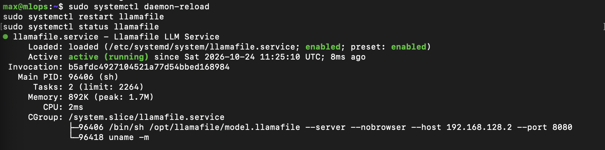
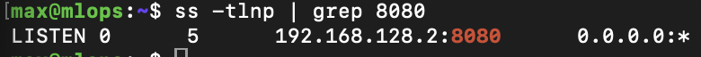
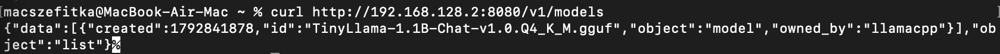
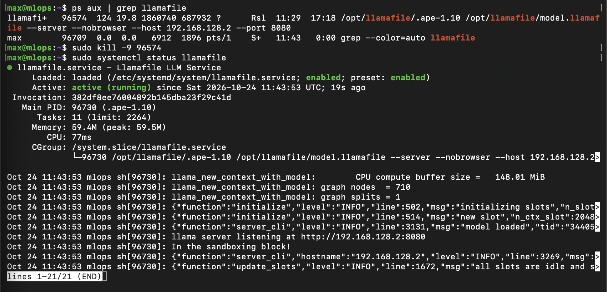

# Pracownia 2 – Usługa llamafile

## Opis zadania
Uruchomienie modelu językowego TinyLlama jako usługi w systemie Linux na maszynie wirtualnej.

## Ustawienia
* Użytkownik: llamafile (usługa działa bez uprawnień root)
* Adres IP: 192.168.128.2:8080 (Host-Only)

## Plik usługi (/etc/systemd/system/llamafile.service)
[Unit]
Description=Llamafile Service
After=network-online.target

[Service]
User=llamafile
WorkingDirectory=/opt/llamafile
Environment=HOME=/opt/llamafile
ExecStart=/bin/sh /opt/llamafile/model.llamafile --server --nobrowser --host 192.168.128.2 --port 8080
Restart=on-failure

[Install]
WantedBy=multi-user.target

## Kroki wykonane na serwerze
1. Utworzenie użytkownika systemowego:
sudo useradd --system --no-create-home llamafile

2. Pobranie modelu i ustawienie uprawnień:
sudo mkdir -p /opt/llamafile
sudo curl -L -o /opt/llamafile/model.llamafile https://huggingface.co/Mozilla/TinyLlama-1.1B-Chat-v1.0-llamafile/resolve/main/TinyLlama-1.1B-Chat-v1.0.Q4_K_M.llamafile
sudo chmod 755 /opt/llamafile/model.llamafile
sudo chown -R llamafile:llamafile /opt/llamafile

3. Uruchomienie usługi w systemd:
sudo systemctl daemon-reload
sudo systemctl enable --now llamafile

## Zrzuty ekranu

1. Status usługi i pamięć (systemctl status):

2. Weryfikacja portu (ss -tlnp):

3. Zapytanie curl z Maca:

4. Test automatycznego restartu (kill -9):

