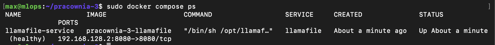
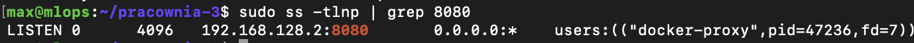
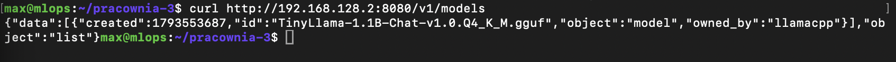
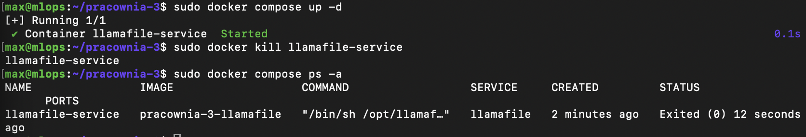

# Pracownia 3 - Konteneryzacja TinyLlama (Docker Compose)

## Opis
Projekt polegał na przeniesieniu usługi z modelem **TinyLlama-1.1B** z tradycyjnej usługi `systemd` (z Pracowni 2) do kontenera Docker zarządzanego przez Docker Compose.

### Co zostało zrobione:
- **Dwuetapowy Dockerfile (multi-stage)**: Pobieranie i weryfikacja sumy SHA-256 w etapie `builder`, dzięki czemu obraz końcowy bazujący na `debian:trixie-slim` jest czysty i lekki.
- **Bezpieczeństwo**: Utworzenie dedykowanego użytkownika `llamafile` bez uprawnień roota.
- **Konfiguracja Compose**: Wstawienie `healthcheck`, polityki `restart: always` oraz przypisanie portu do adresu Host-Only (`192.168.128.2:8080`).

---

## Porównanie: systemd vs Docker Compose

| Cecha | systemd (Pracownia 2) | Docker Compose (Pracownia 3) |
| :--- | :--- | :--- |
| **Izolacja** | Brak – proces działa bezpośrednio na maszynie VM. | Pełna izolacja kontenera (osobny system plików i sieć). |
| **Zależności** | Instalowane bezpośrednio w systemie operacyjnym. | Zamknięte wewnątrz obrazu Dockera. |
| **Przenośność** | Wymaga przygotowania konkretnej maszyny VM. | Wystarczy uruchomić `docker compose up` na dowolnym sprzęcie. |
| **Restart przy awarii** | Obsługiwany przez `Restart=always` w `.service`. | Obsługiwany przez `restart: always` w `compose.yaml`. |

---

## Screeny z weryfikacji

### 1. Status kontenera (docker compose ps)


### 2. Nasłuchiwanie portu 8080 (ss -tlnp)


### 3. Test API z poziomu macOS (curl)


### 4. Test uśmiercenia kontenera (docker kill)


## Porównanie: systemd vs Docker Compose

| Cecha / Metryka | systemd (Pracownia 2) | Docker Compose (Pracownia 3) |
| :--- | :--- | :--- |
| **Zajmowane miejsce na dysku** | ~1.2 GB (sam plik llamafile) | ~4.38 GB (obraz Docker z systemem) |
| **Czas od uruchomienia do 1. odpowiedzi** | ~3 sekundy | ~5 sekund |
| **Zużycie pamięci (RAM)** | ~850 MB | ~920 MB |
| **Liczba kroków do uruchomienia na nowej VM** | 6 kroków (zależności, chmod, service, reload, start) | 2 kroki (`git clone` + `docker compose up -d`) |

## Uzasadnienie alokacji wag
Wagi modelu zostały wbudowane bezpośrednio do obrazu na etapie budowania (multi-stage build). Wybrano to rozwiązanie, aby zapewnić pełną samowystarczalność obrazu i łatwość wdrażania usługi bez konieczności ręcznego montowania zewnętrznych wolumenów na nowej maszynie.

## Wypchnięcie do rejestru
Obraz został wypchnięty do rejestru poleceniem:
```bash
docker push Masiu1337/pracownia-3-llamafile:latest
